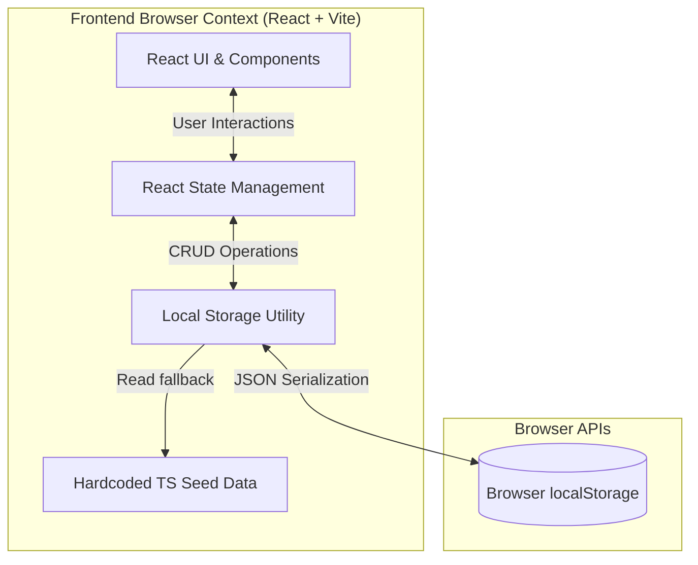
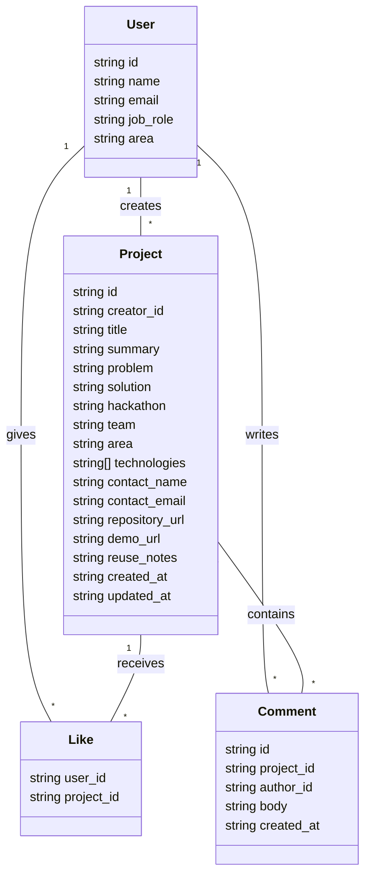

# C&CA Hackathon Hub V1: Architecture & Technical Design

This document outlines the architectural decisions, system components, and data structures for the C&CA Hackathon Hub V1 frontend-only prototype.

## 1. System Overview

To prioritize immediate delivery and simple local demonstration, the V1 application operates as a **Frontend-Only Single Page Application (SPA)**. There is no backend server, no SQL database, and no cloud infrastructure.

State and data persistence are handled entirely within the browser using React state and the browser's `localStorage` API. This allows stakeholders to interact with a fully functioning prototype—including creating, editing, and liking projects—without requiring complex local setup.

## 2. High-Level Architecture Diagram

The following diagram illustrates the flow of data entirely within the client's browser environment.

## 3. Technology Stack

| Component | Technology | Rationale | 
| ----- | ----- | ----- | 
| **Framework** | React + TypeScript + Vite | Standard, highly productive ecosystem. Vite provides rapid local compilation and an easy dev server. | 
| **Styling** | Plain CSS | Keeps the prototype lightweight without needing complex styling libraries. Blue-led, clean corporate aesthetic. | 
| **Data Persistence** | `localStorage` | Preserves user modifications (new posts, likes, comments) across page refreshes without needing a database. | 
| **Authentication** | Simulated | No passwords are collected. Users select a mock profile or create a demo profile to test creator-only permissions. | 

## 4. Data Models

Instead of relational database tables, data is structured using strict TypeScript interfaces. The relationships are maintained via ID references in the JSON payload stored in `localStorage`.

## 5. Security & Permissions Model

**Important:** Because this is a frontend-only prototype, all security constraints are **simulated UI rules** designed to demonstrate user flows, not actual security boundaries.

1. **Authentication:** Visitors select a sample user from a list or create a basic demo profile. No passwords or real SSO integrations are used.
2. **Authorization (Creator-only editing):** The UI checks if the `current_user.id` matches the `project.creator_id`. If they match, the "Edit" button is rendered, and the user can modify the project. Real enforcement will belong to a future backend.
3. **Validation:** Forms validate that either contact details OR a valid HTTP/HTTPS repository URL are provided before saving to local state.

## 6. Seed & Initialization Strategy

To ensure a "ready-to-demo" state while preventing data loss, the application follows a fallback initialization pattern:

* **On first launch:** The local storage utility checks `localStorage` for existing app data.
* **Seeding:** If no data is found, it loads the hardcoded fictional dataset (8 users, 3 hackathons, 12 varied projects, plus sample comments and likes) from a dedicated TypeScript file, serializes it to JSON, and saves it to `localStorage`.
* **Persistence:** All subsequent creates, edits, likes, and comments update the `localStorage` payload, allowing the demo state to survive browser refreshes.
* **Reset:** A "Reset demo data" control is available to wipe `localStorage` and re-inject the pristine seed data, allowing easy reset between demo sessions.